# Store Management API Service

## C3 — Summary

C3 component view of SVC-001 Store Management API Service, showing REST controllers, application services, domain model, repositories, cross-cutting concerns (validation, auth, logging, error handling, health), and the shared relational database and identity provider dependencies.

## C3 — Insights

- The service is a layered modular monolith with clear separation between API controllers, application services, domain model, and persistence repositories, enabling future extraction into microservices per bounded context (customers, products, orders).
- Order creation logic in the Order Application Service depends on both customer and product repositories to enforce referential integrity at the application layer in addition to database foreign keys.
- Cross-cutting concerns (authentication/authorization, validation, error handling, logging, health checks) are centralized, reducing duplication across controllers and improving consistency of behavior and observability.
- The single relational database acts as the consistency boundary for customers, products, and orders, supporting ACID transactions around each write use case, including order placement.
- DTO mapping is explicitly separated from both controllers and domain entities, allowing API contracts to evolve independently from internal domain models.

## C3 — Interfaces

### Customer Management REST API (HTTPS/JSON (REST))
External REST API for managing customer lifecycle operations in the Store Management API Service.

- POST /api/v1/customers
- GET /api/v1/customers
- GET /api/v1/customers/{id}
- PUT /api/v1/customers/{id}
- DELETE /api/v1/customers/{id}

### Product Management REST API (HTTPS/JSON (REST))
External REST API for managing product lifecycle operations in the Store Management API Service.

- POST /api/v1/products
- GET /api/v1/products
- GET /api/v1/products/{id}
- PUT /api/v1/products/{id}
- DELETE /api/v1/products/{id}

### Order Management REST API (HTTPS/JSON (REST))
External REST API for creating, listing, retrieving, and deleting orders that link customers and products.

- POST /api/v1/orders
- GET /api/v1/orders
- GET /api/v1/orders/{id}
- DELETE /api/v1/orders/{id}

### Health Check REST API (HTTPS/JSON (REST))
External REST API endpoint used for liveness and basic readiness checks of the Store Management API Service.

- GET /api/v1/health

### Customer Application Service Interface (In-process function calls)
In-process interface exposing customer lifecycle use cases to API controllers within the Store Management API Service.

- createCustomer(command)
- listCustomers(query)
- getCustomerById(id)
- updateCustomer(id, command)
- deleteCustomer(id)

### Product Application Service Interface (In-process function calls)
In-process interface exposing product lifecycle use cases to API controllers within the Store Management API Service.

- createProduct(command)
- listProducts(query)
- getProductById(id)
- updateProduct(id, command)
- deleteProduct(id)

### Order Application Service Interface (In-process function calls)
In-process interface exposing order-related use cases, including creation, retrieval, listing, and deletion of orders.

- placeOrder(command)
- listOrders(query)
- getOrderById(id)
- deleteOrder(id)

### Customer Repository Interface (SQL via ORM/DB driver)
Data access interface for persisting and retrieving customer entities from the relational database.

- save(customer)
- findById(customerId)
- findAll(offset, limit)
- update(customer)
- deleteById(customerId)

### Product Repository Interface (SQL via ORM/DB driver)
Data access interface for persisting and retrieving product entities from the relational database.

- save(product)
- findById(productId)
- findAll(offset, limit)
- update(product)
- deleteById(productId)

### Order Repository Interface (SQL via ORM/DB driver)
Data access interface for persisting and retrieving order entities from the relational database.

- save(order)
- findById(orderId)
- findAll(offset, limit)
- deleteById(orderId)

### Authentication and Authorization Interface (In-process security framework (e.g., OAuth2/JWT library))
Security filter interface used by API controllers to validate tokens and enforce administrator authorization for management endpoints.

- validateToken(bearerToken)
- extractPrincipal(token)
- checkRole(principal, role)

### Validation Interface (In-process validation framework)
Validation interface providing reusable rules for request DTOs and domain entities across the service.

- validateCustomerRequest(dto)
- validateProductRequest(dto)
- validateOrderRequest(dto)
- validateDomainEntity(entity)

### DTO Mapping Interface (In-process mapping utilities)
Mapping interface for converting between external API DTOs and internal domain entities or command objects.

- toCustomerDomain(customerDto)
- toCustomerResponseDto(customer)
- toProductDomain(productDto)
- toProductResponseDto(product)
- toOrderDomain(orderDto)
- toOrderResponseDto(order)

### Error Handling Interface (In-process web framework middleware)
Framework-level error handling interface that converts internal exceptions into standardized HTTP error responses.

- handleValidationError(error)
- handleNotFoundError(error)
- handleConflictError(error)
- handleUnexpectedError(error)

### Logging and Metrics Interface (In-process logging and metrics libraries)
Observability interface used by components to emit structured logs and metrics for operations and errors.

- logInfo(event, context)
- logWarning(event, context)
- logError(event, context)
- recordMetric(name, value, tags)

### Health Check Component Interface (In-process function calls)
Internal interface used by the health controller to retrieve aggregated health status for the service and database connectivity.

- checkLiveness()
- checkReadiness()
- checkDatabaseConnectivity()


## C3 — Relationships

- admin -> apiCust: Store administrator calls customer endpoints to manage customer records.
- admin -> apiProd: Store administrator calls product endpoints to manage catalog products.
- admin -> apiOrder: Store administrator calls order endpoints to place and manage orders.
- admin -> apiHealth: Store administrator or monitoring tooling calls health endpoint to verify service availability.
- apiCust -> auth: Customer controller invokes security layer to validate tokens and required roles.
- apiProd -> auth: Product controller invokes security layer to validate tokens and required roles.
- apiOrder -> auth: Order controller invokes security layer to validate tokens and required roles.
- auth -> idp: Security layer validates and parses tokens against the external identity provider.
- apiCust -> dtoMapper: Customer controller maps between customer DTOs and domain objects.
- apiProd -> dtoMapper: Product controller maps between product DTOs and domain objects.
- apiOrder -> dtoMapper: Order controller maps between order DTOs and domain objects.
- apiCust -> appCust: Customer controller delegates to customer application service to execute use cases.
- apiProd -> appProd: Product controller delegates to product application service to execute use cases.
- apiOrder -> appOrder: Order controller delegates to order application service to execute use cases.
- appCust -> validation: Customer application service validates customer commands before applying domain logic.
- appProd -> validation: Product application service validates product commands before applying domain logic.
- appOrder -> validation: Order application service validates order commands, including quantity constraints.
- appCust -> domain: Customer application service creates and updates customer aggregates in the domain model.
- appProd -> domain: Product application service creates and updates product aggregates in the domain model.
- appOrder -> domain: Order application service creates and updates order aggregates in the domain model.
- appCust -> repoCust: Customer application service persists and retrieves customer entities via the customer repository.
- appProd -> repoProd: Product application service persists and retrieves product entities via the product repository.
- appOrder -> repoOrder: Order application service persists and retrieves order entities via the order repository.
- appOrder -> repoCust: Order application service checks for existence of customers before placing orders.
- appOrder -> repoProd: Order application service checks for existence of products before placing orders.
- repoCust -> db: Customer repository executes SQL statements to manage customer data.
- repoProd -> db: Product repository executes SQL statements to manage product data.
- repoOrder -> db: Order repository executes SQL statements to manage order data.
- apiCust -> errHandler: Customer controller surfaces errors to centralized error handler for HTTP translation.
- apiProd -> errHandler: Product controller surfaces errors to centralized error handler for HTTP translation.
- apiOrder -> errHandler: Order controller surfaces errors to centralized error handler for HTTP translation.
- apiCust -> logging: Customer controller emits access logs and basic metrics for customer endpoints.
- apiProd -> logging: Product controller emits access logs and basic metrics for product endpoints.
- apiOrder -> logging: Order controller emits access logs and basic metrics for order endpoints.
- appCust -> logging: Customer application service logs business events and decisions.
- appProd -> logging: Product application service logs business events and decisions.
- appOrder -> logging: Order application service logs business events and decisions, such as validation failures.
- errHandler -> logging: Error handler logs structured error events for troubleshooting and alerting.
- healthComp -> logging: Health component emits health-related metrics and log entries.
- apiHealth -> healthComp: Health controller queries health component for liveness and readiness state.
- healthComp -> db: Health component optionally checks database connectivity as part of readiness checks.

## C3 — External dependencies

- Store Management Database: Central relational database storing customers, products, and orders with ACID transactions and referential integrity constraints.
- Identity Provider: External identity provider used to validate and parse tokens for authenticated store administrators.

## C3 — Diagram

```mermaid
flowchart TD

    admin["Store Administrator\n(Person)"]
    idp["Identity Provider\n(System_Ext)"]
    db[("Store Management Database\n(ContainerDb)")]

    subgraph SVC_001["Store Management API Service (SVC-001)"]
        direction TB
        apiCust["Customer API Controller\n(REST Controller)"]
        apiProd["Product API Controller\n(REST Controller)"]
        apiOrder["Order API Controller\n(REST Controller)"]
        apiHealth["Health API Controller\n(REST Controller)"]

        appCust["Customer Application Service\n(Application Service)"]
        appProd["Product Application Service\n(Application Service)"]
        appOrder["Order Application Service\n(Application Service)"]

        domain["Domain Model\n(Customer, Product, Order Aggregates)"]

        repoCust["Customer Repository\n(Repository)"]
        repoProd["Product Repository\n(Repository)"]
        repoOrder["Order Repository\n(Repository)"]

        dtoMapper["DTO Mapping Layer\n(Mapper)"]
        validation["Validation Layer\n(Validation)"]
        auth["AuthN/AuthZ Layer\n(Security)"]
        errHandler["Error Handling Middleware\n(Middleware)"]
        logging["Logging & Observability\n(Observability)"]
        healthComp["Health Check Component\n(Health)"]
    end

    admin -->|"HTTPS/JSON: /api/v1/customers"| apiCust
    admin -->|"HTTPS/JSON: /api/v1/products"| apiProd
    admin -->|"HTTPS/JSON: /api/v1/orders"| apiOrder
    admin -->|"HTTPS/JSON: /api/v1/health"| apiHealth

    apiCust -->|"Validate token & roles"| auth
    apiProd -->|"Validate token & roles"| auth
    apiOrder -->|"Validate token & roles"| auth

    auth -->|"OAuth2/OIDC, JWT validation"| idp

    apiCust -->|"Map request/response DTOs"| dtoMapper
    apiProd -->|"Map request/response DTOs"| dtoMapper
    apiOrder -->|"Map request/response DTOs"| dtoMapper

    apiCust -->|"Invoke customer use cases"| appCust
    apiProd -->|"Invoke product use cases"| appProd
    apiOrder -->|"Invoke order use cases"| appOrder

    appCust -->|"Validate commands"| validation
    appProd -->|"Validate commands"| validation
    appOrder -->|"Validate commands"| validation

    appCust -->|"Use customer aggregates"| domain
    appProd -->|"Use product aggregates"| domain
    appOrder -->|"Use order aggregates"| domain

    appCust -->|"CRUD customers"| repoCust
    appProd -->|"CRUD products"| repoProd
    appOrder -->|"CRUD orders"| repoOrder
    appOrder -->|"Check customer existence"| repoCust
    appOrder -->|"Check product existence"| repoProd

    repoCust -->|"SQL"| db
    repoProd -->|"SQL"| db
    repoOrder -->|"SQL"| db

    apiCust -->|"Log requests"| logging
    apiProd -->|"Log requests"| logging
    apiOrder -->|"Log requests"| logging
    appCust -->|"Log business events"| logging
    appProd -->|"Log business events"| logging
    appOrder -->|"Log business events"| logging
    errHandler -->|"Log errors"| logging
    healthComp -->|"Emit health metrics"| logging

    apiCust -->|"Surface handled errors"| errHandler
    apiProd -->|"Surface handled errors"| errHandler
    apiOrder -->|"Surface handled errors"| errHandler

    apiHealth -->|"Query health status"| healthComp
    healthComp -->|"Optional DB connectivity check"| db
```



## C4 — Classes

- CustomerController
- ProductController
- OrderController
- HealthController
- GlobalExceptionHandler
- CustomerApplicationService
- ProductApplicationService
- OrderApplicationService
- DtoMapper
- ValidationService
- Customer
- Product
- Order
- CustomerRepository
- ProductRepository
- OrderRepository
- JpaCustomerRepositoryImpl
- JpaProductRepositoryImpl
- JpaOrderRepositoryImpl
- StoreDbContext
- ApiSecurityConfig
- LoggingConfig
- RequestLoggingFilter
- CorrelationIdFilter
- AppConfig

## C4 — Summary

Code-level C4 view for SVC-001 (Store Management API Service), showing a layered, modular-monolith Spring-style design for customer, product, and order REST management. Controllers map HTTP contracts to commands/queries and delegate to application services, which orchestrate validation, domain entities, and repositories. Domain entities and value objects (Customer, Product, Order, IDs, Money) capture core data and simple behaviors. Repository interfaces abstract persistence, with JPA-based implementations in the infrastructure layer. Cross-cutting components handle security, logging, correlation IDs, configuration, and exception-to-error-response mapping, supporting deterministic 4xx/404 behavior required by the user stories.

## C4 — Insights

- The design uses a strict layered architecture (presentation → application → domain → infrastructure) and the Controller-Service-Repository pattern, directly reflecting patterns P-01, P-02, and P-13 while keeping modules for customer, product, and order cleanly separated for future extraction into microservices.
- Application services implement the concrete use cases from F-01/F-02 and order features: CRUD operations for customers and products, plus order placement with validation that customer and product exist and quantity > 0, aligning with US-001, US-006–US-009, and US-002.
- DTOs (request/response types) are explicitly separated from domain entities and connected via DtoMapper, implementing P-05; this isolates external REST contracts from internal domain evolution and avoids over-posting risks.
- ValidationService centralizes basic field and invariant checks (names, cities, prices, quantities), while GlobalExceptionHandler converts ValidationException and NotFoundException into deterministic error payloads, satisfying the requirement for consistent 400/404 handling across all endpoints.
- Repository interfaces (CustomerRepository, ProductRepository, OrderRepository) plus JPA-based implementations embody P-04 and P-07, supporting ACID transactions at the service boundary while hiding ORM details from domain and application layers.
- The use of distinct value objects for IDs (CustomerId, ProductId, OrderId) and Money clarifies semantic types and reduces accidental mix-ups between IDs or raw numeric prices, while remaining light enough for the relatively simple domain required by the stories.
- Config and cross-cutting components (ApiSecurityConfig, LoggingConfig, RequestLoggingFilter, CorrelationIdFilter, AppConfig) support token-based auth, structured logging, correlation IDs, and 12-factor configuration without polluting core business classes with infrastructure concerns.
- HealthController and HealthStatusResponse implement a lightweight liveness endpoint in line with P-08, suitable for container orchestration readiness checks and basic operator observability.
- The diagram highlights key dependencies only (e.g., controllers → services → repositories) instead of enumerating all framework glue, keeping the C4 Code view focused on the classes that encode real design decisions and feature behavior.
- Pagination support for list endpoints is reflected in ListCustomersQuery/ListProductsQuery, PagedResult, and PagedResponse, addressing P-11 and ensuring that customer/product listings scale while preserving a simple RESTful interface.

## C4 — Methods

- **?.CustomerController.createCustomer** — Validate request body structurally, delegate to CustomerApplicationService.createCustomer via command, and return 201 with created customer per US-001.
- **?.CustomerController.listCustomers** — Expose paginated customer listing, using defaults from AppConfig and mapping domain PagedResult to PagedResponse.
- **?.CustomerController.getCustomerById** — Retrieve a customer by ID, mapping NotFoundException to 404 per US-001 ACs.
- **?.CustomerController.updateCustomer** — Update fields of existing customer, returning updated representation or 404 if ID unknown.
- **?.CustomerController.deleteCustomer** — Delete a customer by ID, returning appropriate 2xx or 404 with no body.
- **?.ProductController.createProduct** — Create a new product with name and price, returning created representation per US-007.
- **?.ProductController.listProducts** — Return paginated list of all products, including empty list when none exist per US-006.
- **?.ProductController.getProductById** — Return single product by ID or 404 Not Found per US-006.
- **?.ProductController.updateProduct** — Update name and/or price of an existing product per US-008, returning 404 when ID unknown.
- **?.ProductController.deleteProduct** — Delete product by ID with correct success/Not Found behavior per US-009.
- **?.OrderController.createOrder** — Place an order by delegating to OrderApplicationService.placeOrder and translating validation failures to 400 per US-002.
- **?.OrderController.listOrders** — List all orders with their key details per US-003.
- **?.OrderController.getOrderById** — Retrieve a single order by ID or 404 when not found per US-003.
- **?.OrderController.deleteOrder** — Delete an order by ID with correct success/404 behavior per US-004.
- **?.HealthController.health** — Return simple liveness status (and optionally DB reachability) per US-005.
- **?.CustomerApplicationService.createCustomer** — Validate customer fields, construct Customer entity, persist via repository, and return domain entity.
- **?.CustomerApplicationService.listCustomers** — Fetch customers page and total count from repository and wrap them in PagedResult.
- **?.CustomerApplicationService.getCustomer** — Load customer or throw NotFoundException when not present.
- **?.CustomerApplicationService.updateCustomer** — Load, apply changes to name/city via domain methods, validate, and save updated customer.
- **?.CustomerApplicationService.deleteCustomer** — Attempt deletion and throw NotFoundException if repository indicates missing ID.
- **?.ProductApplicationService.createProduct** — Validate name and price, construct Product with Money, persist and return entity.
- **?.ProductApplicationService.listProducts** — Return paginated products and total count for client pagination per P-11.
- **?.ProductApplicationService.getProduct** — Load product or throw NotFoundException for unknown ID.
- **?.ProductApplicationService.updateProduct** — Load product, update name/price via domain methods, validate and save.
- **?.ProductApplicationService.deleteProduct** — Delete product or throw NotFoundException to satisfy US-009 expectations.
- **?.OrderApplicationService.placeOrder** — Validate quantity > 0, ensure referenced customer and product exist, construct and persist Order, or throw ValidationException when checks fail per US-002.
- **?.OrderApplicationService.listOrders** — Return all orders for reporting and retrieval per US-003.
- **?.OrderApplicationService.getOrder** — Retrieve order or throw NotFoundException when ID is unknown.
- **?.OrderApplicationService.deleteOrder** — Delete order or throw NotFoundException per US-004.
- **?.ValidationService.validateCustomerName** — Ensure customer name is present and meets minimal constraints; throw ValidationException if invalid.
- **?.ValidationService.validateCustomerCity** — Validate city field for presence/format; throw ValidationException on failure.
- **?.ValidationService.validateProductName** — Check product name is present and valid; throw ValidationException when rules are broken.
- **?.ValidationService.validateProductPrice** — Ensure price is positive and within acceptable bounds; throw ValidationException otherwise.
- **?.ValidationService.validateOrderQuantity** — Ensure quantity > 0 as required by US-002; throw ValidationException when not met.
- **?.CustomerRepository.findById** — Return existing customer or empty to allow app service to raise NotFoundException.
- **?.CustomerRepository.findAll** — Return slice of customers for pagination.
- **?.CustomerRepository.countAll** — Expose total customer count to compute pagination metadata.
- **?.CustomerRepository.deleteById** — Delete customer by ID and indicate whether a record was removed.
- **?.ProductRepository.deleteById** — Delete product and signal existence to support correct 404 responses per US-009.
- **?.OrderRepository.deleteById** — Delete order and signal existence for 404 handling per US-004.
- **?.GlobalExceptionHandler.handleValidation** — Convert validation failures into 400 Bad Request with structured ErrorResponse payload.
- **?.GlobalExceptionHandler.handleNotFound** — Convert NotFoundException into 404 error responses across all resources.
- **?.RequestLoggingFilter.filter** — Wraps HTTP pipeline to log request/response data and correlation ID for observability.
- **?.CorrelationIdFilter.filter** — Ensures each HTTP request has a correlation ID propagated downstream.
- **?.ApiSecurityConfig.configureAuthentication** — Configure JWT/OAuth2 authentication with organizational IdP.
- **?.ApiSecurityConfig.configureAuthorization** — Restrict management endpoints to admin roles via RBAC rules.

## C4 — Data structures

- Customer
- Product
- Order
- CustomerId
- ProductId
- OrderId
- Money
- CreateCustomerRequest
- UpdateCustomerRequest
- CustomerResponse
- CreateProductRequest
- UpdateProductRequest
- ProductResponse
- CreateOrderRequest
- OrderResponse
- ErrorResponse
- HealthStatusResponse
- PagedResponse<T>
- AppConfig

## C4 — Code relationships

- Controller delegates all customer-related operations to the application service, keeping HTTP concerns separated from business logic.
- Controller delegates product lifecycle actions to ProductApplicationService per F-02.
- Controller delegates order placement, listing, retrieval, and deletion to OrderApplicationService per EP-003 stories.
- Health endpoint may optionally verify DB accessibility or simply confirm app liveness.
- Service uses repository to persist and load Customer entities inside transactions.
- Service uses repository for product CRUD and pagination.
- Service uses repository to create, list, retrieve, and delete orders.
- Reads customers during order placement to validate existence per US-002.
- Reads products during order placement to validate existence per US-002.
- Service calls validation methods before creating or updating customers.
- Service validates product name and price when creating or updating products.
- Service validates order quantity and may reuse common rules on customer/product IDs.
- Maps between Customer domain objects and CustomerResponse DTOs.
- Maps Product entities to ProductResponse DTOs and vice versa.
- Maps Order entities and PlaceOrderCommand to OrderResponse and Order objects.
- Infrastructure adapter that fulfills CustomerRepository interface using JPA/ORM.
- Infrastructure adapter that fulfills ProductRepository interface using JPA/ORM.
- Infrastructure adapter that fulfills OrderRepository interface using JPA/ORM.
- Represents the connection to the underlying relational database used for all persistence.
- Builds structured error responses when handling thrown exceptions from deeper layers.
- Uses configured logger settings to emit structured request/response logs.
- Uses logging configuration and headers to propagate correlation IDs.
- Applies authentication/authorization constraints to management controllers, enforcing admin-only access.

## C4 — Diagram

```mermaid
classDiagram
  direction LR

  class CustomerController {
    +createCustomer(req: CreateCustomerRequest) CustomerResponse
    +listCustomers(offset: int, limit: int) PagedResponse~CustomerResponse~
    +getCustomerById(id: UUID) CustomerResponse
    +updateCustomer(id: UUID, req: UpdateCustomerRequest) CustomerResponse
    +deleteCustomer(id: UUID) void
  }

  class ProductController {
    +createProduct(req: CreateProductRequest) ProductResponse
    +listProducts(offset: int, limit: int) PagedResponse~ProductResponse~
    +getProductById(id: UUID) ProductResponse
    +updateProduct(id: UUID, req: UpdateProductRequest) ProductResponse
    +deleteProduct(id: UUID) void
  }

  class OrderController {
    +createOrder(req: CreateOrderRequest) OrderResponse
    +listOrders() List~OrderResponse~
    +getOrderById(id: UUID) OrderResponse
    +deleteOrder(id: UUID) void
  }

  class HealthController {
    +health() HealthStatusResponse
  }

  class GlobalExceptionHandler {
    +handleValidation(ex: ValidationException) ErrorResponse
    +handleNotFound(ex: NotFoundException) ErrorResponse
    +handleConflict(ex: ConflictException) ErrorResponse
    +handleGeneric(ex: Exception) ErrorResponse
  }

  class CustomerApplicationService {
    +createCustomer(cmd: CreateCustomerCommand) Customer
    +listCustomers(query: ListCustomersQuery) PagedResult~Customer~
    +getCustomer(id: CustomerId) Customer
    +updateCustomer(cmd: UpdateCustomerCommand) Customer
    +deleteCustomer(id: CustomerId) void
  }

  class ProductApplicationService {
    +createProduct(cmd: CreateProductCommand) Product
    +listProducts(query: ListProductsQuery) PagedResult~Product~
    +getProduct(id: ProductId) Product
    +updateProduct(cmd: UpdateProductCommand) Product
    +deleteProduct(id: ProductId) void
  }

  class OrderApplicationService {
    +placeOrder(cmd: PlaceOrderCommand) Order
    +listOrders() List~Order~
    +getOrder(id: OrderId) Order
    +deleteOrder(id: OrderId) void
  }

  class DtoMapper {
    +toCustomer(cmd: CreateCustomerCommand) Customer
    +toCustomerResponse(c: Customer) CustomerResponse
    +toProduct(cmd: CreateProductCommand) Product
    +toProductResponse(p: Product) ProductResponse
    +toOrder(cmd: PlaceOrderCommand, c: Customer, p: Product) Order
    +toOrderResponse(o: Order) OrderResponse
  }

  class ValidationService {
    +validateCustomerName(name: String) void
    +validateCustomerCity(city: String) void
    +validateProductName(name: String) void
    +validateProductPrice(price: BigDecimal) void
    +validateOrderQuantity(qty: int) void
  }

  class Customer {
    -id: CustomerId
    -name: String
    -city: String
    +getId() CustomerId
    +getName() String
    +getCity() String
    +rename(newName: String) void
    +moveToCity(newCity: String) void
  }

  class Product {
    -id: ProductId
    -name: String
    -price: Money
    +getId() ProductId
    +getName() String
    +getPrice() Money
    +rename(newName: String) void
    +changePrice(newPrice: Money) void
  }

  class Order {
    -id: OrderId
    -customerId: CustomerId
    -productId: ProductId
    -quantity: int
    +getId() OrderId
    +getCustomerId() CustomerId
    +getProductId() ProductId
    +getQuantity() int
  }

  class CustomerId {
    -value: UUID
    +of(value: UUID) CustomerId
    +getValue() UUID
  }

  class ProductId {
    -value: UUID
    +of(value: UUID) ProductId
    +getValue() UUID
  }

  class OrderId {
    -value: UUID
    +of(value: UUID) OrderId
    +getValue() UUID
  }

  class Money {
    -amount: BigDecimal
    -currency: String
    +of(amount: BigDecimal, currency: String) Money
    +getAmount() BigDecimal
    +getCurrency() String
  }

  class CustomerRepository {
    <<interface>>
    +save(c: Customer) Customer
    +findById(id: CustomerId) Optional~Customer~
    +findAll(offset: int, limit: int) List~Customer~
    +countAll() long
    +deleteById(id: CustomerId) boolean
  }

  class ProductRepository {
    <<interface>>
    +save(p: Product) Product
    +findById(id: ProductId) Optional~Product~
    +findAll(offset: int, limit: int) List~Product~
    +countAll() long
    +deleteById(id: ProductId) boolean
  }

  class OrderRepository {
    <<interface>>
    +save(o: Order) Order
    +findById(id: OrderId) Optional~Order~
    +findAll() List~Order~
    +deleteById(id: OrderId) boolean
  }

  class JpaCustomerRepositoryImpl {
    +save(c: Customer) Customer
    +findById(id: CustomerId) Optional~Customer~
    +findAll(offset: int, limit: int) List~Customer~
    +countAll() long
    +deleteById(id: CustomerId) boolean
  }

  class JpaProductRepositoryImpl {
    +save(p: Product) Product
    +findById(id: ProductId) Optional~Product~
    +findAll(offset: int, limit: int) List~Product~
    +countAll() long
    +deleteById(id: ProductId) boolean
  }

  class JpaOrderRepositoryImpl {
    +save(o: Order) Order
    +findById(id: OrderId) Optional~Order~
    +findAll() List~Order~
    +deleteById(id: OrderId) boolean
  }

  class StoreDbContext {
    +getEntityManager() EntityManager
  }

  class ApiSecurityConfig {
    +configureAuthentication() void
    +configureAuthorization() void
  }

  class LoggingConfig {
    +configureStructuredLogging() void
  }

  class CreateCustomerRequest {
    +name: String
    +city: String
  }

  class UpdateCustomerRequest {
    +name: String
    +city: String
  }

  class CustomerResponse {
    +id: UUID
    +name: String
    +city: String
  }

  class CreateProductRequest {
    +name: String
    +price: BigDecimal
  }

  class UpdateProductRequest {
    +name: String
    +price: BigDecimal
  }

  class ProductResponse {
    +id: UUID
    +name: String
    +price: BigDecimal
  }

  class CreateOrderRequest {
    +customerId: UUID
    +productId: UUID
    +quantity: int
  }

  class OrderResponse {
    +id: UUID
    +customerId: UUID
    +productId: UUID
    +quantity: int
  }

  class ErrorResponse {
    +code: String
    +message: String
    +details: Map~String, Object~
  }

  class HealthStatusResponse {
    +status: String
  }

  class PagedResponse~T~ {
    +items: List~T~
    +total: long
    +offset: int
    +limit: int
  }

  class AppConfig {
    +dbUrl: String
    +dbUser: String
    +dbPassword: String
    +pageSizeDefault: int
    +pageSizeMax: int
  }

  class RequestLoggingFilter {
    +filter(request, response, chain) void
  }

  class CorrelationIdFilter {
    +filter(request, response, chain) void
  }

  class NotFoundException {
  }

  class ValidationException {
  }

  class ConflictException {
  }

  GlobalExceptionHandler --> ErrorResponse
  GlobalExceptionHandler --> NotFoundException
  GlobalExceptionHandler --> ValidationException
  GlobalExceptionHandler --> ConflictException

  CustomerController --> CustomerApplicationService
  ProductController --> ProductApplicationService
  OrderController --> OrderApplicationService
  HealthController --> StoreDbContext

  CustomerApplicationService --> CustomerRepository
  CustomerApplicationService --> ValidationService
  CustomerApplicationService --> DtoMapper

  ProductApplicationService --> ProductRepository
  ProductApplicationService --> ValidationService
  ProductApplicationService --> DtoMapper

  OrderApplicationService --> OrderRepository
  OrderApplicationService --> CustomerRepository
  OrderApplicationService --> ProductRepository
  OrderApplicationService --> ValidationService
  OrderApplicationService --> DtoMapper

  JpaCustomerRepositoryImpl ..|> CustomerRepository
  JpaProductRepositoryImpl ..|> ProductRepository
  JpaOrderRepositoryImpl ..|> OrderRepository

  RequestLoggingFilter --> LoggingConfig
  CorrelationIdFilter --> LoggingConfig
  ApiSecurityConfig --> CustomerController
  ApiSecurityConfig --> ProductController
  ApiSecurityConfig --> OrderController
```



## API specification — Endpoints

### POST /api/v1/customers
Creates a new customer with name and city. Returns the created customer including generated ID.

### GET /api/v1/customers
Returns a list of all customers. Supports basic pagination via limit and offset query parameters.

### GET /api/v1/customers/{id}
Retrieves a single customer by its ID.

### PUT /api/v1/customers/{id}
Replaces an existing customer’s name and/or city. Full update semantics for the defined fields.

### DELETE /api/v1/customers/{id}
Deletes an existing customer by ID. Not found IDs return 404 and do not modify any records.

### POST /api/v1/products
Creates a new product with name and price. Returns the created product including generated ID.

### GET /api/v1/products
Returns a list of all products with their ID, name, and price. Supports basic pagination via limit and offset.

### GET /api/v1/products/{id}
Retrieves a single product by its ID.

### PUT /api/v1/products/{id}
Updates an existing product’s name and/or price using full update semantics for the defined fields.

### DELETE /api/v1/products/{id}
Deletes an existing product by ID. Not found IDs return 404 and do not modify other products.

### POST /api/v1/orders
Creates a new order linking an existing customer and product with a positive quantity. Validates that the customer and product exist and that quantity is greater than zero.

### GET /api/v1/orders
Returns a list of all orders with customer reference, product reference, quantity, and ID. Supports basic pagination via limit and offset.

### GET /api/v1/orders/{id}
Retrieves a single order by ID including customer reference, product reference, quantity, and order ID.

### DELETE /api/v1/orders/{id}
Deletes an existing order by ID. If the order does not exist, returns 404 without affecting any other orders.

### GET /api/v1/health
Simple health check indicating that the service is running. Does not expose deep diagnostics.


## API specification — Summary

RESTful API specification for the Store Management API Service covering customer, product, order, and health-check endpoints required by features F-01 and F-02 and related user stories. The design uses JSON payloads, simple resource-oriented URLs under /api/v1, standard HTTP methods and status codes, bearer token authentication for management endpoints, and a consistent error response model. Pagination is supported via limit and offset for list endpoints, and domain validation ensures basic business rules such as non-empty names, positive prices, and positive quantities.

## API specification — Insights

- The API is intentionally minimal and feature-focused: only endpoints needed for customer, product, order management, and health checks are included—no speculative auth flows, MFA, HATEOAS links, or advanced versioning headers are defined beyond the /api/v1 path prefix.
- A uniform error model (ErrorResponse) simplifies client integration and aligns with the requirement for deterministic and structured errors, especially around ID not-found cases and validation failures for name, price, and quantity.
- Bearer JWT authentication is defined as the sole security mechanism at the API level, which is sufficient for administrator-only use cases while allowing integration with a variety of enterprise IdPs. Health checks are left unauthenticated to support standard load balancer probes.
- List endpoints for customers, products, and orders share a consistent pagination contract using limit and offset, enabling straightforward horizontal scaling and predictable payload sizes without over-engineering filtration or sorting rules that are not yet required.
- Order creation explicitly models business rule failures (unknown customer/product, non-positive quantity) as 400 Bad Request rather than 404, matching the user story expectations and avoiding information leakage about separate customer/product stores.
- The OpenAPI specification and embedded Postman collection work together: the OpenAPI spec is the canonical contract for generators and documentation, while the Postman collection offers immediate, concrete examples for manual testing and stakeholder review.
- By reusing common schemas (e.g., Customer, Product, Order) across request and response models, the design keeps the domain representation consistent while still permitting future divergence (additional read-only fields, computed properties) without breaking existing clients.

API version: 1.0.0

## API specification — Data models

### Customer

### CustomerCreateRequest

### CustomerUpdateRequest

### CustomerResponse

### CustomerListResponse

### Product

### ProductCreateRequest

### ProductUpdateRequest

### ProductResponse

### ProductListResponse

### Order

### OrderCreateRequest

### OrderResponse

### OrderListResponse

### HealthResponse

### ErrorResponse

### PostmanCollection


## API specification — Authentication

- Rate limiting: {'policy': 'Not specified in requirements; to be defined by platform or gateway. API is designed to be stateless and compatible with token- or IP-based throttling at the gateway layer.'}

## API specification — Error handling

- Use standard HTTP status codes: 200 for successful retrieval and updates, 201 for successful resource creation, 204 for successful deletions with no body, 400 for validation or business rule violations on the client side (including non-existent customer or product when placing orders, or non-positive quantity), 401 for missing or invalid authentication, 404 for unknown resource IDs on GET/PUT/DELETE, 415 for unsupported media type when Content-Type is not application/json where a body is expected, and 500 for unexpected server errors.
- All error responses (except 204) use a consistent JSON structure defined by ErrorResponse with fields: timestamp, correlationId, status, error, code, message, and optional details for field-level issues.
- Validation errors (e.g., missing required fields, invalid formats, constraint violations like empty name/city or non-positive price/quantity) should set status=400, error="Bad Request", code="VALIDATION_ERROR", and populate details[] entries with field, issue, and rejectedValue when safe.
- Not-found conditions for customers, products, and orders (GET/PUT/DELETE by ID) return 404 with status=404, error="Not Found", and a code such as "CUSTOMER_NOT_FOUND", "PRODUCT_NOT_FOUND", or "ORDER_NOT_FOUND". The message should not expose internal implementation details.
- Business rule violations when placing orders (non-existent customer or product, or quantity <= 0) are modeled as 400 with specific codes like "UNKNOWN_CUSTOMER", "UNKNOWN_PRODUCT", or "INVALID_QUANTITY" to allow clients to react appropriately.
- The centralized error handler must ensure that internal exceptions do not leak stack traces or SQL details in error responses; such cases should map to 500 with a generic message while logging the underlying exception with the correlationId.
- Authentication and authorization failures are represented as 401 (Unauthorized) when the bearer token is missing or invalid. More advanced 403/role-level semantics can be added later if required by security standards.

## OpenAPI specification

```json
openapi: 3.0.3
info:
  title: Store Management API Service
  version: 1.0.0
  description: |
    REST API for managing customers, products, and orders in a simple store management
    system. Supports CRUD operations for customers and products, order creation and basic
    retrieval/deletion, and a lightweight health check.
servers:
  - url: https://api.example.com
    description: Production server (example; replace with actual hostname)
  - url: http://localhost:8080
    description: Local development server
paths:
  /api/v1/customers:
    post:
      summary: Create a new customer
      description: Creates a new customer with name and city. Returns the created customer including generated ID.
      operationId: createCustomer
      tags: [Customers]
      security:
        - BearerAuth: []
      requestBody:
        required: true
        content:
          application/json:
            schema:
              $ref: '#/[REDACTED-AWS_SECRET_KEY]'
      responses:
        '201':
          description: Customer created successfully
          content:
            application/json:
              schema:
                $ref: '#/components/schemas/Customer'
        '400':
          description: Validation error in request body
          content:
            application/json:
              schema:
                $ref: '#/components/schemas/ErrorResponse'
        '401':
          description: Unauthorized – missing or invalid bearer token
          content:
            application/json:
              schema:
                $ref: '#/components/schemas/ErrorResponse'
        '415':
          description: Unsupported media type (only application/json is accepted)
          content:
            application/json:
              schema:
                $ref: '#/components/schemas/ErrorResponse'
        '500':
          description: Unexpected server error
          content:
            application/json:
              schema:
                $ref: '#/components/schemas/ErrorResponse'
    get:
      summary: List customers
      description: Returns a list of all customers. Supports basic pagination via limit and offset query parameters.
      operationId: listCustomers
      tags: [Customers]
      security:
        - BearerAuth: []
      parameters:
        - in: query
          name: limit
          schema:
            type: integer
            minimum: 1
            maximum: 100
            default: 50
          required: false
          description: Maximum number of customers to return.
        - in: query
          name: offset
          schema:
            type: integer
            minimum: 0
            default: 0
          required: false
          description: Number of customers to skip before starting to collect the result set.
      responses:
        '200':
          description: List of customers (possibly empty)
          content:
            application/json:
              schema:
                $ref: '#/components/schemas/CustomerListResponse'
        '401':
          description: Unauthorized – missing or invalid bearer token
          content:
            application/json:
              schema:
                $ref: '#/components/schemas/ErrorResponse'
        '500':
          description: Unexpected server error
          content:
            application/json:
              schema:
                $ref: '#/components/schemas/ErrorResponse'
  /api/v1/customers/{id}:
    get:
      summary: Get customer by ID
      description: Retrieves a single customer by its ID.
      operationId: getCustomerById
      tags: [Customers]
      security:
        - BearerAuth: []
      parameters:
        - in: path
          name: id
          required: true
          schema:
            type: string
          description: ID of the customer to retrieve.
      responses:
        '200':
          description: Customer found
          content:
            application/json:
              schema:
                $ref: '#/components/schemas/Customer'
        '401':
          description: Unauthorized – missing or invalid bearer token
          content:
            application/json:
              schema:
                $ref: '#/components/schemas/ErrorResponse'
        '404':
          description: Customer with given ID not found
          content:
            application/json:
              schema:
                $ref: '#/components/schemas/ErrorResponse'
        '500':
          description: Unexpected server error
          content:
            application/json:
              schema:
                $ref: '#/components/schemas/ErrorResponse'
    put:
      summary: Update customer by ID
      description: Replaces an existing customer’s name and/or city.
      operationId: updateCustomer
      tags: [Customers]
      security:
        - BearerAuth: []
      parameters:
        - in: path
          name: id
          required: true
          schema:
            type: string
          description: ID of the customer to update.
      requestBody:
        required: true
        content:
          application/json:
            schema:
              $ref: '#/[REDACTED-AWS_SECRET_KEY]'
      responses:
        '200':
          description: Customer updated successfully
          content:
            application/json:
              schema:
                $ref: '#/components/schemas/Customer'
        '400':
          description: Validation error in request body
          content:
            application/json:
              schema:
                $ref: '#/components/schemas/ErrorResponse'
        '401':
          description: Unauthorized – missing or invalid bearer token
          content:
            application/json:
              schema:
                $ref: '#/components/schemas/ErrorResponse'
        '404':
          description: Customer with given ID not found
          content:
            application/json:
              schema:
                $ref: '#/components/schemas/ErrorResponse'
        '415':
          description: Unsupported media type (only application/json is accepted)
          content:
            application/json:
              schema:
                $ref: '#/components/schemas/ErrorResponse'
        '500':
          description: Unexpected server error
          content:
            application/json:
              schema:
                $ref: '#/components/schemas/ErrorResponse'
    delete:
      summary: Delete customer by ID
      description: Deletes an existing customer by ID. Not found IDs return 404 and do not modify any records.
      operationId: deleteCustomer
      tags: [Customers]
      security:
        - BearerAuth: []
      parameters:
        - in: path
          name: id
          required: true
          schema:
            type: string
          description: ID of the customer to delete.
      responses:
        '204':
          description: Customer deleted successfully
        '401':
          description: Unauthorized – missing or invalid bearer token
          content:
            application/json:
              schema:
                $ref: '#/components/schemas/ErrorResponse'
        '404':
          description: Customer with given ID not found
          content:
            application/json:
              schema:
                $ref: '#/components/schemas/ErrorResponse'
        '500':
          description: Unexpected server error
          content:
            application/json:
              schema:
                $ref: '#/components/schemas/ErrorResponse'
  /api/v1/products:
    post:
      summary: Create a new product
      description: Creates a new product with name and price. Returns the created product including generated ID.
      operationId: createProduct
      tags: [Products]
      security:
        - BearerAuth: []
      requestBody:
        required: true
        content:
          application/json:
            schema:
              $ref: '#/components/schemas/ProductCreateRequest'
      re

_(truncated -- content exceeds the reference file size budget)_
```
