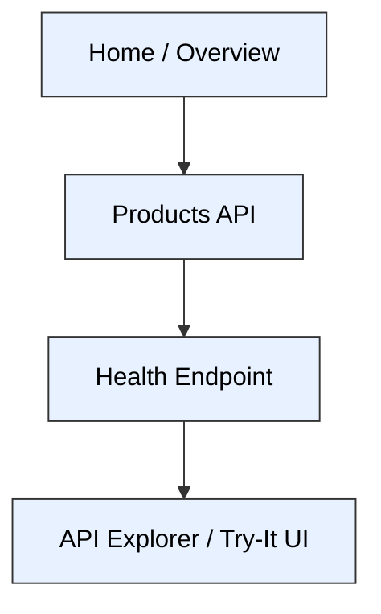
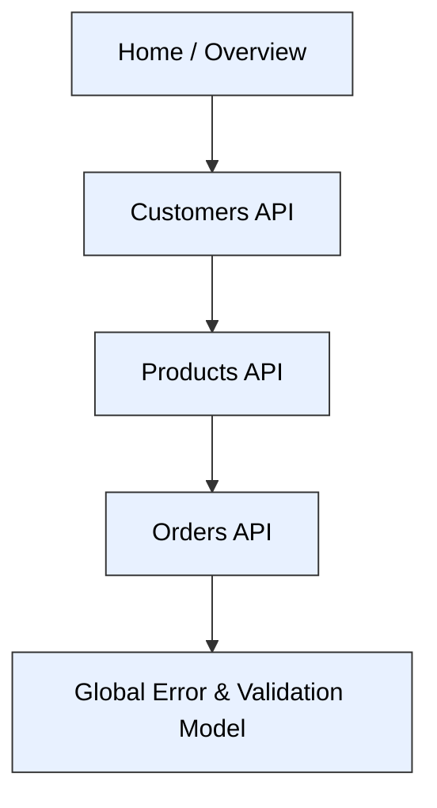
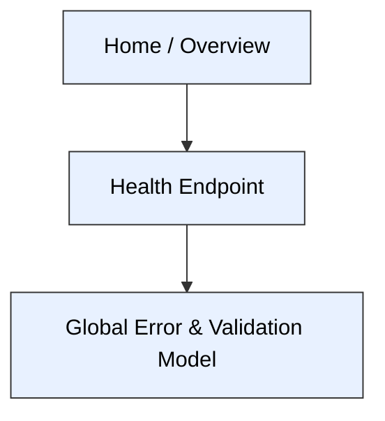

# User flows

## Dana automates product catalog updates
Dana discovers product endpoints, checks service health, and uses the API Explorer to create and update products reliably.

### Diagram

## Luis integrates order placement
Luis navigates entity docs to design order placement, ensuring valid references and consistent error handling across customers, products, and orders.

### Diagram

## Mei configures health-based monitoring
Mei uses the overview to find /health documentation, then reviews health semantics and error models to configure reliable monitoring.

### Diagram

